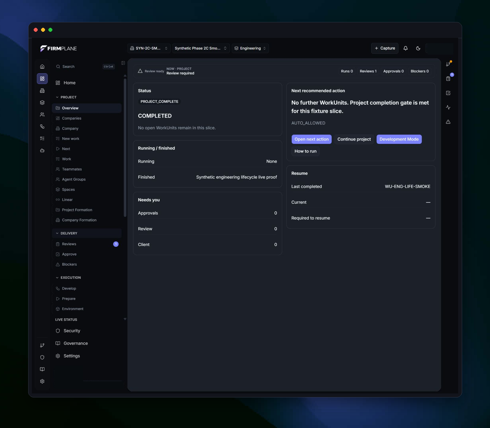
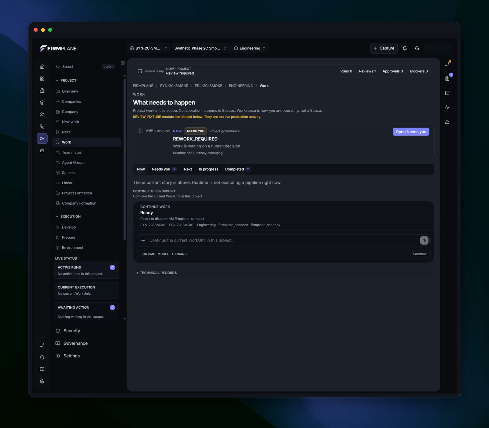
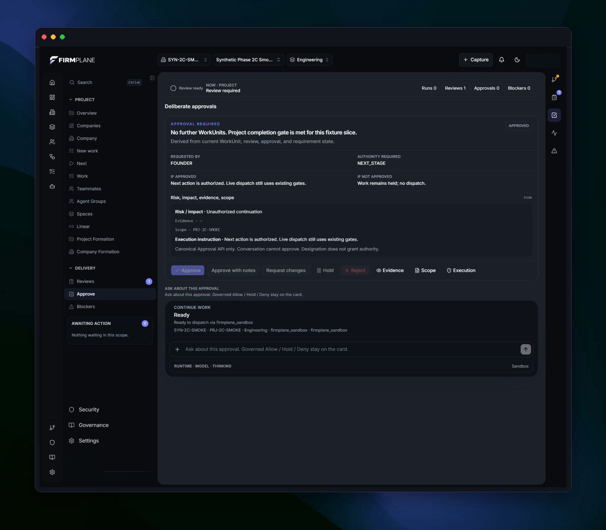
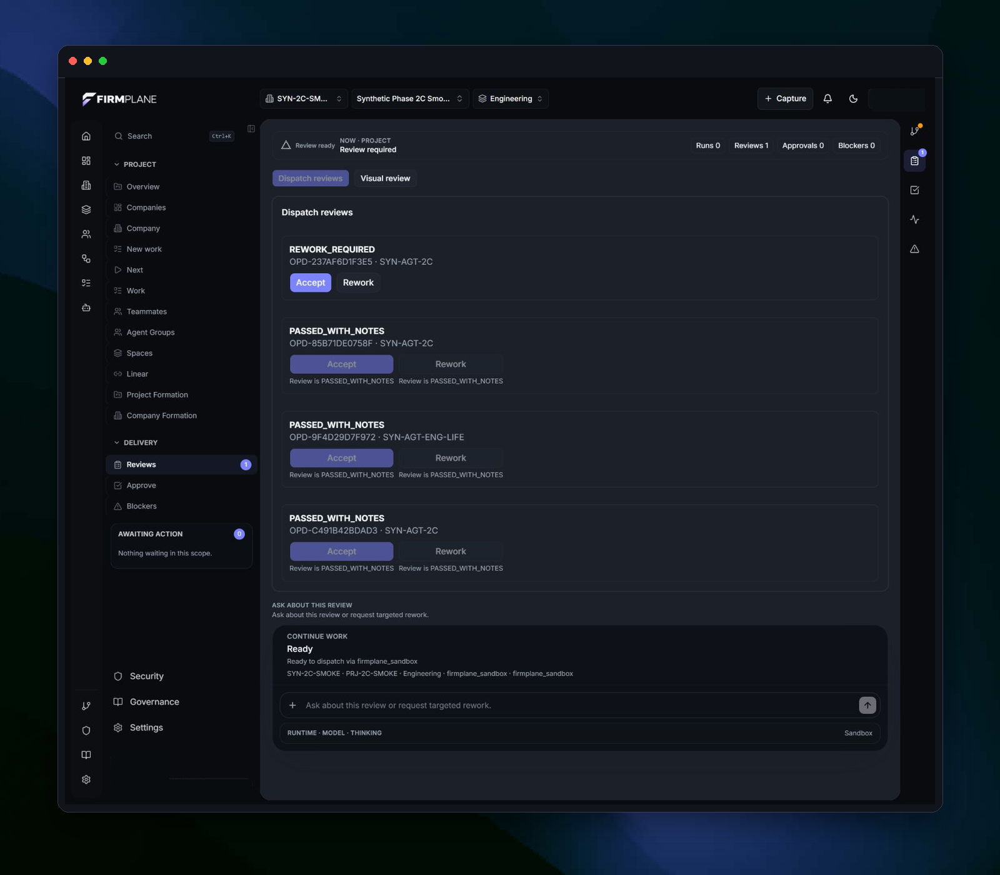

# FIRMPLANE AI Delivery Governance

Technical documentation for FIRMPLANE as a governed AI-assisted product delivery and execution control system.

## Documentation

- [System model](docs/system-model.md)
- [Work-unit lifecycle](docs/work-unit-lifecycle.md)
- [Authority and control](docs/authority-and-control.md)
- [Evidence and review](docs/evidence-and-review.md)

## System flow

Project → Work Unit → Role / Agent → Coding Handoff → Evidence → Review → Status

## A Look Inside

<table>
  <tr>
    <td width="50%">
      
      <br /><strong>Project Overview</strong><br />Track governed project status, attention, and the next permitted action.
    </td>
    <td width="50%">
      
      <br /><strong>Governed Work</strong><br />Keep work-unit state, human decisions, and runtime readiness explicit.
    </td>
  </tr>
  <tr>
    <td width="50%">
      
      <br /><strong>Approval Control</strong><br />Review authority, evidence, scope, and execution consequences before dispatch.
    </td>
    <td width="50%">
      
      <br /><strong>Evidence Review</strong><br />Review returned evidence, record rework, and preserve explicit verification outcomes.
    </td>
  </tr>
</table>

## Working Reference Implementation

The TypeScript modules in [`src/`](src/) make selected governance controls executable: work-unit readiness, authority and workspace checks, explicit state transitions, execution exit conditions, evidence requirements, and independent verification.

## Run Locally

```bash
npm ci
npm run typecheck
npm test
npm run demo
```

## What the Code Demonstrates

- [`authority.ts`](src/authority.ts) — fail-closed execution readiness, approval, capability, and repository checks.
- [`work-unit.ts`](src/work-unit.ts) — explicit lifecycle transitions and final-state protection.
- [`exit-policy.ts`](src/exit-policy.ts) — deterministic execution-limit and no-progress outcomes.
- [`evidence.ts`](src/evidence.ts) and [`verification.ts`](src/verification.ts) — evidence completeness and independent-review requirements.
- [`governance.test.ts`](tests/governance.test.ts) — accepted, blocked, stopped, and escalated paths.
- [`governed-run.ts`](examples/governed-run.ts) — one accepted path and one intentionally blocked path.

## Reference Model

[`schema/reference-governance.schema.json`](schema/reference-governance.schema.json) defines a simplified public model for work-unit state, execution decisions, and evidence.

## Scope and Boundary

This repository contains a public reference implementation of selected FIRMPLANE governance controls. It is not the complete private FIRMPLANE system and does not contain private infrastructure, proprietary operating logic, production credentials, or customer data.

## License

Source code in this repository is licensed under the [MIT License](LICENSE).

Documentation, screenshots, diagrams, and other non-code assets are © 2026 Saleh Mukhrish. All rights reserved.

© 2026 Saleh Mukhrish. All rights reserved.
