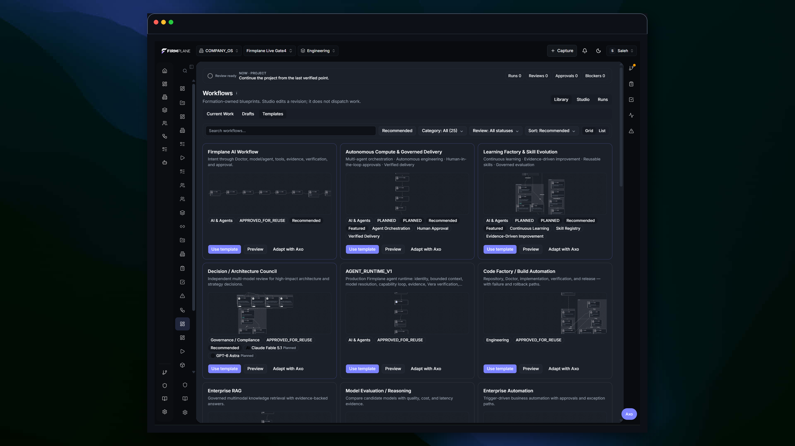
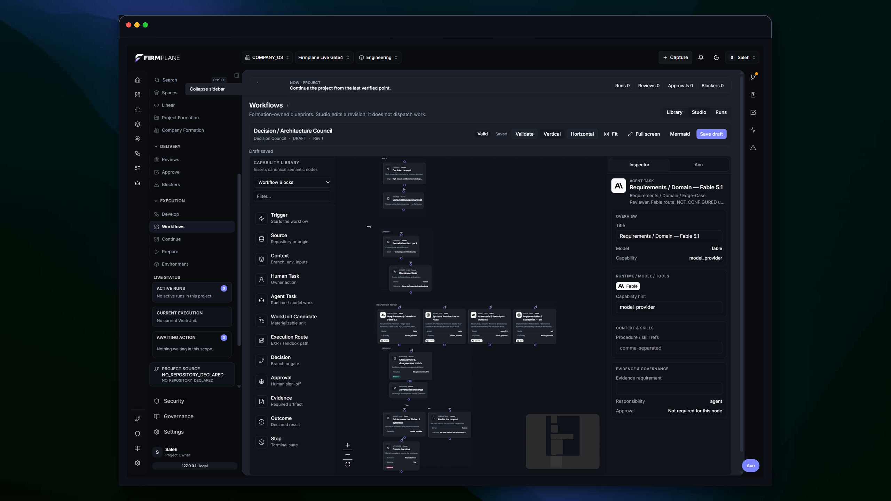
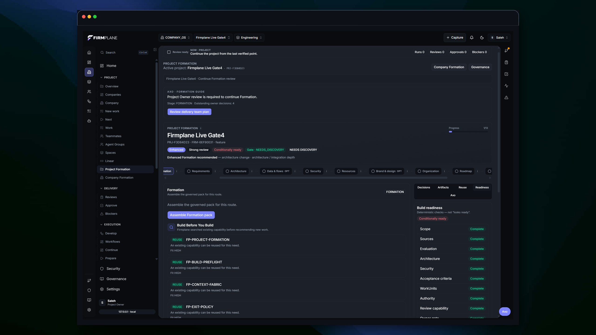
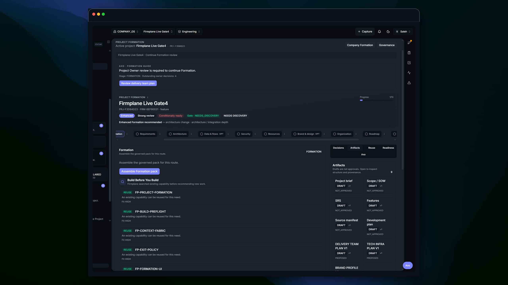

# FIRMPLANE AI Delivery Governance

This repository provides a standalone TypeScript reference implementation of selected execution-governance controls, including authorization checks, lifecycle transitions, execution limits, evidence requirements, and review preconditions.

The reference implementation demonstrates reusable governance checks and testable state behavior.

## Documentation

- [System model](docs/system-model.md)
- [Work-unit lifecycle](docs/work-unit-lifecycle.md)
- [Authority and control](docs/authority-and-control.md)
- [Evidence and review](docs/evidence-and-review.md)

## Public capabilities

The public modules validate declared authority, enforce explicit work-unit transitions, bound execution attempts, validate required evidence kinds, and require a review precondition before verification. They return typed accepted or blocked decisions.

## A Look Inside

<p></p>

**Workflow Library**<br />
Explore reusable workflow templates across engineering, AI, operations, and governance.

<p></p>

**Workflow Studio**<br />
Design and inspect workflow nodes, branches, capabilities, and approval requirements.

<p></p>

**Formation Readiness**<br />
Assess project readiness, required controls, and pending decisions before execution.

<p></p>

**Engineering Artifacts**<br />
Maintain structured project briefs, requirements, scopes, and delivery plans with explicit review states.

## Working Reference Implementation

The TypeScript modules in [`src/`](src/) make selected governance controls executable: work-unit readiness, authority and workspace checks, explicit state transitions, execution exit conditions, evidence requirements, and review preconditions.

## Run Locally

```bash
npm ci
npm run typecheck
npm test
npm run demo
```

## What the Code Demonstrates

- [`authority.ts`](src/authority.ts) — fail-closed execution readiness, approval, capability, and repository checks.
- [`work-unit.ts`](src/work-unit.ts) — explicit lifecycle transitions and final-state protection.
- [`exit-policy.ts`](src/exit-policy.ts) — deterministic execution-limit and no-progress outcomes.
- [`evidence.ts`](src/evidence.ts) and [`verification.ts`](src/verification.ts) — evidence completeness and review preconditions.
- [`governance.test.ts`](tests/governance.test.ts) — accepted, blocked, stopped, and escalated paths.
- [`governed-run.ts`](examples/governed-run.ts) — one accepted path and one intentionally blocked path.

## Reference Model

[`schema/reference-governance.schema.json`](schema/reference-governance.schema.json) defines a simplified public model for work-unit state, execution decisions, and evidence.

## Scope & Limitations

This repository contains a public reference implementation of selected governance controls. It validates declared decisions and state transitions but does not execute tools, persist canonical state, resolve identity, or provide a complete policy engine.

## Contributing

See [CONTRIBUTING.md](CONTRIBUTING.md) for the local verification workflow and contribution boundaries.

## License

Source code in this repository is licensed under the [MIT License](LICENSE).

Documentation, screenshots, diagrams, and other non-code assets are © 2026 Saleh Mukhrish. All rights reserved.
